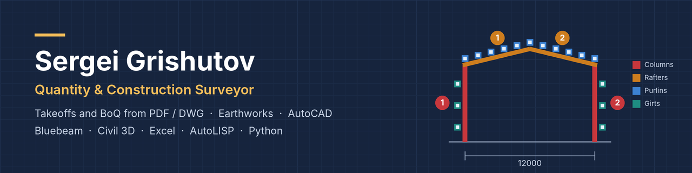
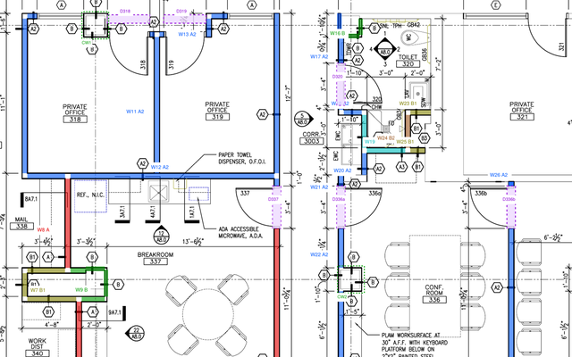
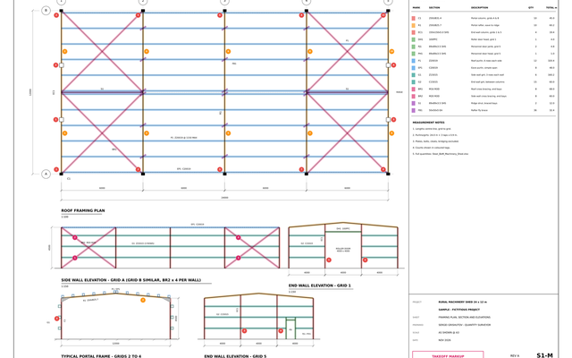
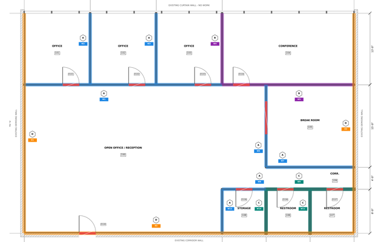
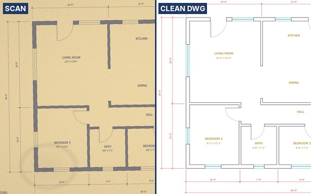
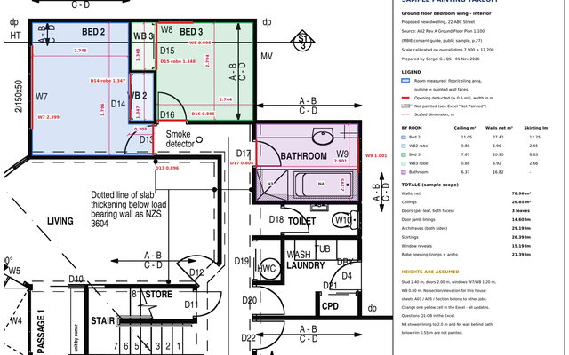
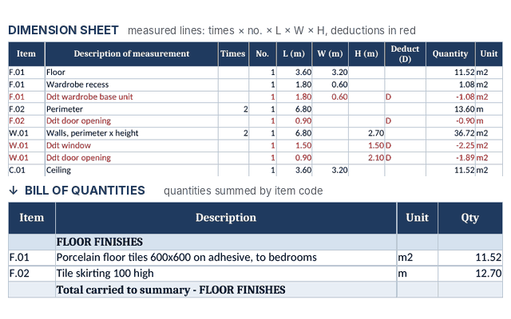

Quantity surveyor and former head of a construction survey department, 11+ years in construction. For ten years I worked on sites in Moscow: metro and airport tunnels, office buildings, luxury housing and towers up to 50 storeys. Now I measure villas, townhouses and apartment buildings in Cyprus. I turn PDF and DWG drawings and survey data into quantities you can check line by line.

## What I can do for you
| Service | What you get |
| --- | --- |
| **Quantity takeoff & BoQ** | Drywall and ceilings, finishes, concrete, masonry, doors and windows, MEP counts. Excel with a drawing reference on every line, plus a colour PDF markup |
| **Structural steel takeoff** | Member list by mark, lengths, kg/m and weights, waste allowance, marked-up drawings |
| **Earthworks** | Cut and fill from survey points, contours or a grading plan. TIN volumes checked by grid and cross-sections, cut/fill map, topsoil and shrink stated |
| **Survey drafting** | Survey data to clean topographic and as-built drawings in AutoCAD and Civil 3D |
| **AutoCAD drafting** | Floor plans and site plans, PDF or image to a clean layered DWG, permit sheets |
| **Automation** | AutoLISP, Excel, Python and SQL for repetitive takeoff work |

## Work samples
<table>
<tr>
<td width="50%"> <b>Drywall and ceilings, real public bid set</b>: 686 LF in 9 types, 8,215 SF of ACT</td>
<td width="50%"> <b>Structural steel takeoff</b>: colour markup, Excel BoM with weights</td>
</tr>
<tr>
<td width="50%"> <b>Drywall and ceilings, US units</b>: partitions by type, GWB, studs, ACT and grid</td>
<td width="50%"> <b>Scan to clean DWG</b>: layers, door and window blocks, true dimensions</td>
</tr>
<tr>
<td width="50%"> <b>Painting takeoff</b>: room by room, walls, ceilings, doors and trims</td>
<td width="50%"> <b>BoQ template</b>: every quantity traced to a measured line</td>
</tr>
</table>

Client work is under NDA, so the samples use public bid drawings or sample drawings I prepared. No client data.

## How I work
1. **Read the whole set first.** Missing dimensions and conflicts go on a query list before measuring.
2. **Measure with a colour markup.** One colour per item, so you can see what is included and what is not.
3. **Excel with references.** Every line shows the drawing, the location and the dimensions used.
4. **Check before delivery.** Totals are cross-checked by a second method (for example, room by room against gross area, or TIN volumes against a grid). Assumptions and exclusions are listed.

## Working with me
| Send me | You get |
| --- | --- |
| Drawings: PDF or DWG, the full set if you have it. For earthworks: survey points or contours and the grading design | Excel takeoff, or your own template filled in |
| Scope: the trades or items to measure | Colour PDF markup of everything measured |
| Your measuring rules or a sample of your format | Query list with assumptions and exclusions |
| Deadline and units (metric or imperial) | Totals cross-checked before delivery |

Not sure yet? I can start with one sheet or one trade so you can check the format first.

## Background
- **Construction surveying, Moscow**: from mine surveyor on the metro and two Sheremetyevo Airport tunnels (TBM) to head of the survey department. Setting out, topographic and as-built surveys with Sokkia and Leica total stations and GNSS, deformation monitoring, thousands of as-built drawings, earthwork volumes in Civil 3D, monthly checks of contractors' quantities.
- **Quantity surveying, Cyprus**: BoQs for villas, townhouses and an apartment building for a real estate developer.
- **Education**: mining engineer (NUST MISIS). One-year data analytics program at Yandex Practicum, 2025-2026 (SQL, Python, Excel, BI).

## Repositories
- [steel-takeoff-tools](https://github.com/Grishutov/steel-takeoff-tools): Python tools for steel weights and Excel BoM, with a worked example
- [takeoff-samples](https://github.com/Grishutov/takeoff-samples): takeoff and drafting samples (Excel, PDF markups, DWG)
- [boq-measurement-template](https://github.com/Grishutov/boq-measurement-template): Excel dimension sheet → BoQ → summary
- [autocad-takeoff-lisp](https://github.com/Grishutov/autocad-takeoff-lisp): AutoLISP routines for lengths, areas and quantities by layer
- [cad-guides](https://github.com/Grishutov/cad-guides): short practical guides (georeferencing a DWG, PDF to DWG, cut and fill volumes)

## Tools

Based in Cyprus (UTC+2) · English, Russian · Metric and imperial units
