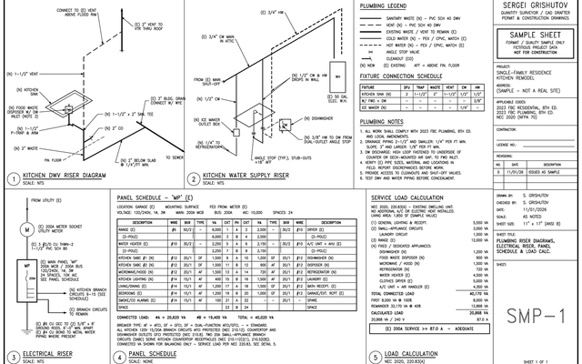

Quantity surveyor with 11+ years in construction. I started as a land surveyor and site engineer (including metro construction) and now measure villas, townhouses and apartment buildings. I turn PDF and DWG drawings into quantities you can check line by line.

## What I can do for you
| Service | What you get |
| --- | --- |
| **Quantity takeoff & BoQ** | Drywall and ceilings, finishes, concrete, masonry, doors and windows, MEP counts. Excel with a drawing reference on every line, plus a colour PDF markup |
| **Structural steel takeoff** | Member list by mark, lengths, kg/m and weights, waste allowance, marked-up drawings |
| **AutoCAD drafting** | Floor plans and site plans, PDF or image to a clean layered DWG, permit sheets |
| **Civil 3D** | Surfaces, grading, cut and fill volumes |
| **Automation** | AutoLISP, Excel and Python for repetitive takeoff work |

## Work samples
<table>
<tr>
<td width="50%"> <b>Structural steel takeoff</b>: colour markup, Excel BoM with weights</td>
<td width="50%"> <b>Drywall and ceilings, US units</b>: partitions by type, GWB, studs, ACT and grid</td>
</tr>
<tr>
<td width="50%"> <b>Scan to clean DWG</b>: layers, door and window blocks, true dimensions</td>
<td width="50%"> <b>Painting takeoff</b>: room by room, walls, ceilings, doors and trims</td>
</tr>
<tr>
<td width="50%"> <b>BoQ template</b>: every quantity traced to a measured line</td>
<td width="50%"> <b>AutoCAD permit sheet</b>: risers, panel schedule, load calc</td>
</tr>
</table>

Client work is under NDA, so the samples use public drawings or sample drawings I prepared. No client data.

## How I work
1. **Read the whole set first.** Missing dimensions and conflicts go on a query list before measuring.
2. **Measure with a colour markup.** One colour per item, so you can see what is included and what is not.
3. **Excel with references.** Every line shows the drawing, the location and the dimensions used.
4. **Check before delivery.** Totals are cross-checked by a second method (for example, room by room against gross area). Assumptions and exclusions are listed.

## Working with me
| Send me | You get |
| --- | --- |
| Drawings: PDF or DWG, the full set if you have it | Excel takeoff, or your own template filled in |
| Scope: the trades or items to measure | Colour PDF markup of everything measured |
| Your measuring rules or a sample of your format | Query list with assumptions and exclusions |
| Deadline and units (metric or imperial) | Totals cross-checked before delivery |

Not sure yet? I can start with one sheet or one trade so you can check the format first.

## Repositories
- [steel-takeoff-tools](https://github.com/Grishutov/steel-takeoff-tools): Python tools for steel weights and Excel BoM, with a worked example
- [takeoff-samples](https://github.com/Grishutov/takeoff-samples): takeoff and drafting samples (Excel, PDF markups, sheets)
- [boq-measurement-template](https://github.com/Grishutov/boq-measurement-template): Excel dimension sheet → BoQ → summary
- [autocad-takeoff-lisp](https://github.com/Grishutov/autocad-takeoff-lisp): AutoLISP routines for lengths, areas and quantities by layer
- [cad-guides](https://github.com/Grishutov/cad-guides): short practical guides (georeferencing a DWG, PDF to DWG)

## Tools

Based in Cyprus (UTC+2) · English, Russian · Metric and imperial units
